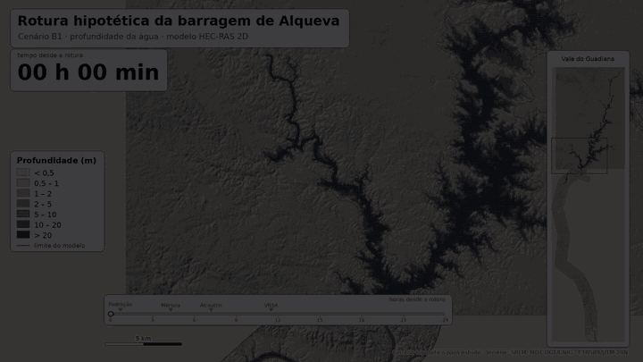
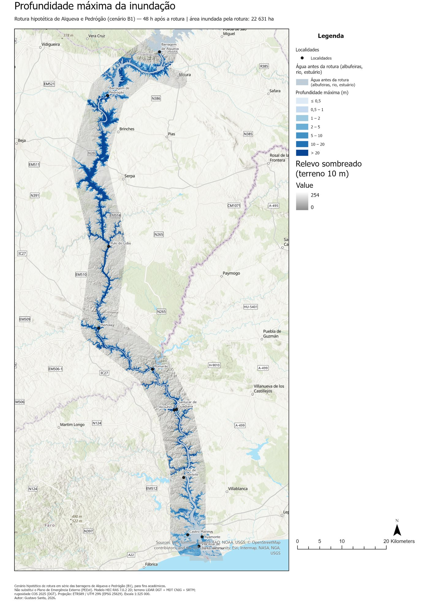
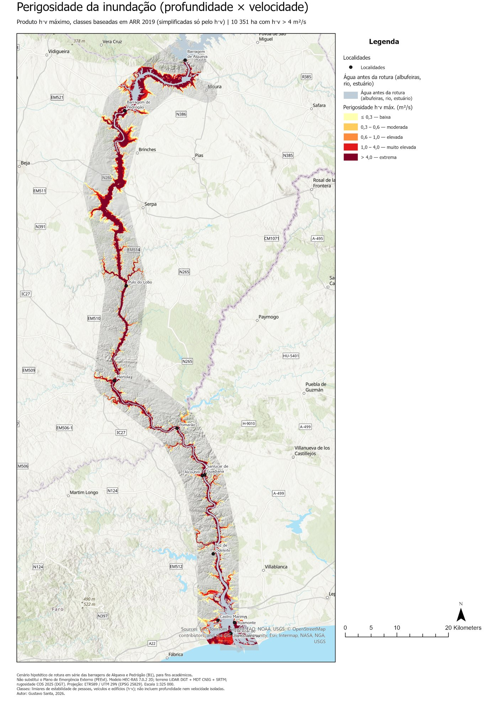
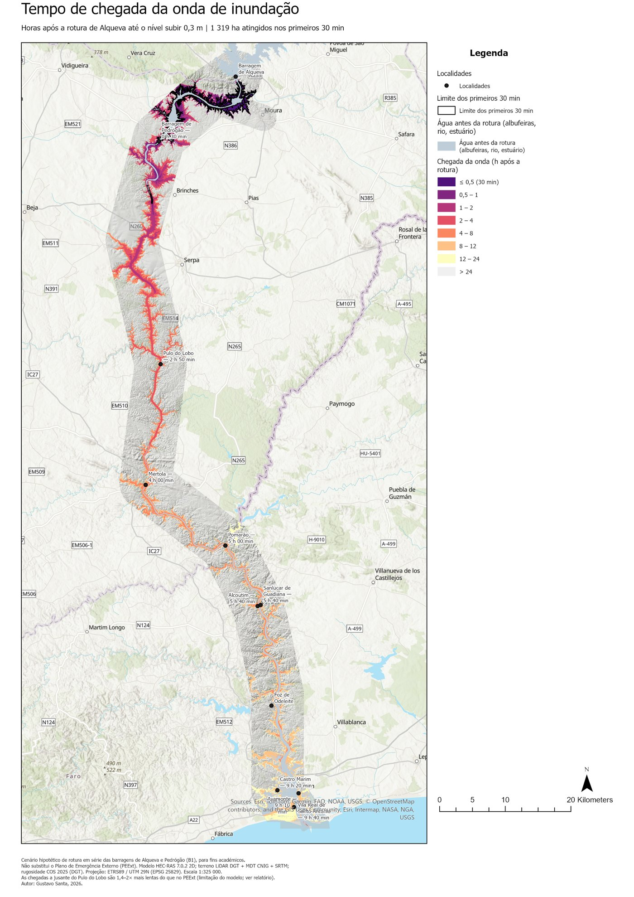
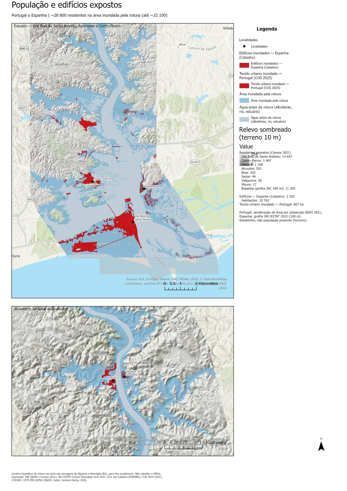

# E se a barragem de Alqueva rompesse?

**Simulação hidráulica 2D de um cenário hipotético de rotura das barragens de Alqueva e Pedrógão**, e propagação da onda de cheia pelo Guadiana até ao mar, em 24 horas. Feito com HEC-RAS 7.0.2, ArcGIS Pro 3.6 e Python, **só com dados abertos**.

> ⚠️ **Cenário hipotético, para estudo e portefólio.** Não é um plano de emergência e **não substitui** o Plano de Emergência Externo (PEExt) da barragem de Alqueva, que é o documento oficial. O PEExt foi usado só como referência para validar o modelo.



🎬 Vídeo completo (59 s, 1080p): [`docs/media/b1_rotura_alqueva_2d.mp4`](docs/media/b1_rotura_alqueva_2d.mp4) · 🌐 Página do projeto: `https://gustavosanta-star.github.io/rotura-alqueva/` · 📄 [Relatório técnico](docs/relatorio_tecnico.md) · 🖼️ [Flyer (PDF)](docs/media/flyer_b1.pdf)

## Em números

| | |
|---|---|
| Caudal máximo a jusante de Alqueva | **~210 000 m³/s** |
| Área inundada pela onda | **22 631 ha** |
| Área com perigosidade extrema (h·v > 4 m²/s) | **10 351 ha** |
| Residentes em zona inundada (Portugal + Espanha) | **~28 800** |
| Chegada da onda | Pedrógão **0 h 42** · Mértola **4 h 18** · Alcoutim **7 h 12** · Vila Real de Santo António **11 h 30** |

## Mapas

| Profundidade máxima | Perigosidade (h·v) | Tempo de chegada | Exposição |
|---|---|---|---|
|  |  |  |  |

## Como foi feito

1. **Terreno:** LiDAR da DGT (2 m → 10 m) no vale; MDT do CNIG em Espanha; SRTM de 2000 para o fundo das albufeiras (anterior ao enchimento); canal esquemático no estuário.
2. **Modelo HEC-RAS 2D:**
   - albufeira e vale como duas áreas 2D, com malha de 100 m refinada a 50 m no canhão;
   - rugosidade de Manning a partir da COS 2025;
   - brechas em Alqueva e em Pedrógão (esta rompe em cascata, 29 min depois).
3. **Validação:**
   - hidrograma do PEExt imposto 5 km a jusante;
   - níveis dentro de ±3 m até ao km 55;
   - as limitações a jusante do Pulo do Lobo estão documentadas.
4. **Cenário B1:** 56 h de simulação e mapas de 10 em 10 min.
5. **Produtos (ArcGIS Pro + Python):**
   - mapas de profundidade, perigosidade, chegada e exposição (INE BGRI 2021, grelha JRC 2021, Catastro);
   - vídeo 2D gerado por código;
   - animação 3D em ArcGIS Pro;
   - flyer.

Pormenores, tabelas de validação e limitações: **[relatório técnico](docs/relatorio_tecnico.md)**.

## Limitações principais
- Chegadas **1,4–2× mais lentas** do que no PEExt a jusante do Pulo do Lobo: não devem ser lidas como tempos de aviso.
- Níveis sobrestimados a jusante do Pulo do Lobo (garganta mais estreita do que a malha).
- Foz com nível fixo (2 m) e área inundada subestimada nos sapais, que encostam ao limite do modelo.
- Exposição com população uniforme por subsecção ou célula de 100 m (residentes, não população presente).

## Estrutura

```
scripts/        Python (ArcGIS Pro/arcpy e Python normal), numerados pela ordem de execução
  00–05         área de estudo, descarga de dados abertos, terreno, curva cota-volume
  06–12         barragens, resultados do HEC-RAS, COS → Manning, comparação com o PEExt
  13–15         produtos do B1, exposição (PT e ES), layouts A3
  16–22         dados da cena 3D, imagens de 2 min, vídeo 2D, animação 3D
  23            flyer A4
  kit/          geração da batimetria, das linhas de referência e dos ficheiros HEC-RAS
  util/         leitura/escrita de GeoTIFF e projeção UTM sem GDAL
docs/           relatório técnico, página web (GitHub Pages) e media
```

Os dados (vários GB) e o modelo HEC-RAS **não estão no repositório**: obtêm-se das fontes indicadas no relatório. Nos scripts, troca `C:\caminho\para\rotura-alqueva` pela pasta do teu projeto.

## Fontes de dados
DGT (MDT LiDAR, COS 2025) · CNIG (MDT 5 m) · NASA/USGS (SRTM) · INE (BGRI e Censos 2021) · JRC/Eurostat (Census Population Grid 2021) · Dirección General del Catastro (INSPIRE) · ANEPC (PEExt de Alqueva, usado como referência). Cada fonte tem a sua licença e os seus termos de atribuição.

## Licença
- Código: [MIT](LICENSE).
- Texto, mapas, vídeo e imagens: CC BY 4.0, com atribuição a Gustavo Santa.

---
**Gustavo Santa** · Engenharia geoespacial · [gustavosanta-star.github.io](https://gustavosanta-star.github.io) · ORCID [0009-0008-4266-0732](https://orcid.org/0009-0008-4266-0732)

<sub>Projeto pessoal, feito fora do âmbito profissional, só com dados abertos.</sub>
